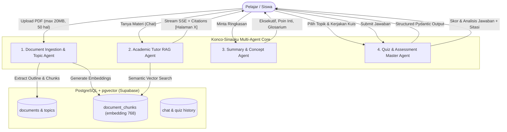

# AGENTS.md: Panduan Arsitektur Multi-Agent & Protokol AI Coding Agent
# Platform: Konco-Sinauku (AI Study Buddy)

Dokumen ini memiliki dua fungsi utama:
1. **Bagian I (Runtime Multi-Agent Architecture)**: Mendefinisikan spesifikasi peran, batasan, dan alur kerja 4 Agen AI yang beroperasi di dalam sistem Konco-Sinauku.
2. **Bagian II (Coding Agent Operating Protocols)**: Menetapkan aturan wajib, standar kode, batasan arsitektur, dan protokol verifikasi bagi AI Coding Assistant (seperti Antigravity, Cursor, Copilot) yang bekerja mengembangkan repositori ini.

---

# BAGIAN I: SPESIFIKASI RUNTIME MULTI-AGENT

Sistem Konco-Sinauku mengorkestrasi 4 Agen AI terspesialisasi untuk memberikan pengalaman belajar yang aman, faktual, dan interaktif bagi pelajar:



---

### 1. Document Ingestion & Topic Agent
* **Tujuan**: Memproses dokumen belajar PDF siswa agar siap dijadikan basis pengetahuan RAG.
* **Tanggung Jawab**:
  1. Validasi berkas: Menolak file yang berukuran > 20 MB atau memiliki panjang > 50 halaman (HTTP 413 / 400).
  2. Ekstraksi teks per halaman dengan `pypdf`, mempertahankan nomor halaman asli.
  3. Ekstraksi outline / daftar bab (*Table of Contents*) untuk dijadikan pilihan topik kuis dan navigasi belajar.
  4. Chunking semantik dengan ukuran ~800 karakter dan overlap ~150 karakter.
  5. Menghitung embedding 768-dimensi via Google Gemini `text-embedding-004` dan menyimpannya secara batch ke tabel `document_chunks` di PostgreSQL (`pgvector`).
* **Aturan Khusus**: Agen dilarang menyimpan teks dokumen mentah sebagai variabel global di memori. Setiap dokumen harus diasosiasikan dengan `user_id` pemiliknya.

---

### 2. Academic Tutor (RAG Chat) Agent
* **Tujuan**: Menjawab pertanyaan siswa secara cerdas, objektif, dan faktual berdasarkan materi dokumen aktif.
* **Persona**: **Asisten Akademis Formal**. Gaya bahasa formal, lugas, santun, tidak bertele-tele, dan selalu berbasis data dokumen.
* **Tanggung Jawab**:
  1. Melakukan *similarity search* menggunakan Cosine Distance (`<=>`) di `pgvector` untuk mengambil 4-5 chunk paling relevan.
  2. Menyusun prompt dengan instruksi ketat: **HANYA jawab berdasarkan konteks yang diberikan; jika materi tidak ditemukan dalam dokumen, nyatakan dengan jujur tanpa berspekulasi**.
  3. Memberikan sitasi wajib dalam format tag khusus `[Halaman X]` di akhir penjelasan fakta penting.
  4. Mengirimkan token respon secara real-time melalui Server-Sent Events (SSE).
* **Integrasi UI**: Tag sitasi `[Halaman X]` harus dikenali oleh frontend agar dapat memicu fungsi *auto-jump* pada PDF viewer di panel sebelah kiri.

---

### 3. Summary & Concept Agent
* **Tujuan**: Merangkum isi materi secara terstruktur agar siswa dapat mereview konsep kunci dengan cepat.
* **Format Output Wajib**:
  - **Ringkasan Eksekutif**: 1-2 paragraf padat mengenai gambaran umum materi.
  - **Poin-Poin Inti**: 5-10 butir pokok bahasan krusial yang sering keluar pada ujian.
  - **Glosarium Istilah**: Daftar istilah teknis penting beserta definisi singkatnya.

---

### 4. Quiz & Assessment Master Agent
* **Tujuan**: Menguji pemahaman siswa melalui kuis pilihan ganda yang disesuaikan dengan topik/bab tertentu.
* **Tanggung Jawab**:
  1. Menerima parameter: `document_id`, `topic` (bab pilihan atau kustom), dan `num_questions` (1 - 10 soal).
  2. Menggunakan fitur **Gemini Structured Output** dengan skema Pydantic (`QuizQuestion` & `QuizGenerateResponse`).
  3. Menjamin setiap soal memiliki 4 opsi (`A`, `B`, `C`, `D`), indikator kunci jawaban, penjelasan akademis yang mendalam (mengapa opsi benar tepat dan mengapa opsi lain salah), serta nomor halaman referensi.
  4. Tidak membocorkan status jawaban atau analisis ke UI sebelum siswa menekan tombol *"Submit Semua Jawaban"*.

---

# BAGIAN II: PROTOKOL WAJIB BAGI AI CODING AGENT

Setiap AI Coding Assistant (Antigravity, Cursor, Copilot, dll) yang membaca repositori ini **WAJIB MEMATUHI** aturan-aturan di bawah ini:

### 1. Standar Type Safety & Bahasa
- **Frontend**: Wajib menggunakan **TypeScript** murni dengan mode `strict: true` di `tsconfig.json`. Dilarang menggunakan tipe `any` tanpa alasan yang sangat mendesak. Semua antarmuka API harus memiliki deklarasi tipe di `frontend/src/types/index.ts`.
- **Backend**: Wajib menggunakan **Python 3.11+ type hints** pada semua fungsi, router, dan service. Validasi payload request dan response wajib menggunakan **Pydantic v2 BaseModel**.

### 2. Larangan Global State di Memori (Zero In-Memory Globals)
- **DILARANG KERAS** mengulang pola kode lama seperti:
  ```python
  # SALAH / DILARANG:
  pdf_content = {"text": ""} 
  current_quiz = []
  ```
- Seluruh state dokumen, obrolan, dan kuis harus tersimpan di PostgreSQL (Supabase) dengan relasi `user_id` dan `document_id`.

### 3. Penanganan Error yang Eksplisit (No Silent Failures)
- **DILARANG** menggunakan blok `except: pass` atau menangkap exception tanpa logging.
- Gunakan `HTTPException` FastAPI dengan kode status yang tepat:
  - `400 Bad Request`: Format input atau file tidak valid.
  - `401 Unauthorized`: Token Supabase JWT hilang atau tidak valid.
  - `404 Not Found`: Dokumen atau sesi tidak ditemukan.
  - `413 Payload Too Large`: Ukuran PDF melebihi 20 MB atau lebih dari 50 halaman.
  - `500 Internal Server Error`: Kesalahan sistem yang wajib disertai log terperinci.

### 4. Arsitektur Antarmuka Split-Screen
- Komponen frontend harus mempertahankan pembagian panel:
  - **Panel Kiri**: Komponen PDF Viewer interaktif.
  - **Panel Kanan**: 3 Modul Belajar (Chat, Summary, Quiz).
- Setiap elemen sitasi halaman (`[Halaman X]`) yang di-render di Chat atau Kuis harus memiliki event handler `onClick={() => setPdfPage(X)}` untuk menggerakkan viewer di panel kiri secara instan.

### 5. Skema Format Kuis (Gemini Structured Outputs)
- Pembuatan kuis tidak boleh lagi menggunakan regex atau string replace manual (`.replace("```json", "")`).
- Selalu gunakan `response_mime_type="application/json"` dan `response_schema=QuizGenerateResponse` pada Gemini SDK untuk memastikan kehandalan 100%.

### 6. Protokol Verifikasi Wajib (Verification Protocol)
Sebelum Coding Agent menyatakan suatu task atau perubahan kode selesai:
1. **Frontend Verification**: Jalankan typecheck dan build:
   ```bash
   cd frontend
   npm run build
   ```
   *Ekspektasi: Selesai dengan kode keluar 0 dan tanpa error TypeScript.*
2. **Backend Verification**: Jalankan import check dan test script:
   ```bash
   cd backend
   python -c "import app.main; print('FastAPI App Loaded Successfully')"
   pytest
   ```
   *Ekspektasi: Seluruh router dan dependency termuat tanpa error ModuleNotFound atau syntax error.*
3. **Konvensi Git**: Commit pesan harus deskriptif mengikuti standar conventional commits (misal: `feat(rag): add chunking and pgvector search`).

---
*Dokumen ini merupakan pedoman resmi dan wajib dipatuhi oleh seluruh agent dan pengembang platform Konco-Sinauku.*
