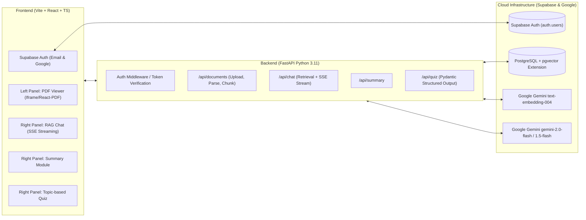

# Product Requirements Document (PRD)
# Platform: Konco-Sinauku (AI-Powered Student Study Buddy)

- **Product Name**: Konco-Sinauku
- **Document Version**: 1.0.0
- **Status**: Approved / In Development
- **Target Audience**: Pelajar (SMA/SMK), Mahasiswa, dan Pendidik di Indonesia
- **Tech Stack**: FastAPI (Python 3.11), Vite + React (TypeScript), PostgreSQL + pgvector (Supabase), Google Gemini LLM & Embeddings

---

## 1. Executive Summary & Problem Statement

### 1.1 Latar Belakang
Pelajar saat ini seringkali dihadapkan pada materi pembelajaran berbentuk dokumen digital (PDF modul, buku ajar, slide presentasi) dengan volume ratusan halaman. Mempelajari dan mencari materi spesifik secara manual membutuhkan waktu lama. Di sisi lain, penggunaan model kecerdasan buatan umum (seperti ChatGPT mentah) rentan terhadap masalah *halusinasi* (jawaban tidak sesuai buku pegangan siswa) serta ketiadaan rujukan halaman dokumen asli yang dapat divalidasi.

### 1.2 Solusi: Konco-Sinauku
**Konco-Sinauku** (*Teman Belajar*) adalah platform web pembelajaran berbasis *True RAG* (Retrieval-Augmented Generation) yang terintegrasi dengan Google Gemini. Platform ini memungkinkan siswa:
1. Mengunggah dokumen materi belajar (PDF).
2. Membaca dokumen asli di sisi kiri (*Split-Screen PDF Viewer*).
3. Berinteraksi secara bersamaan di sisi kanan melalui **3 Modul Belajar Utama**:
   - **Tanya Jawab (RAG Chat)** dengan sitasi halaman materi asli (`[Halaman X]`) yang dapat diklik untuk langsung melompat ke halaman PDF di panel kiri.
   - **Ringkasan Dokumen** untuk intisari materi dan poin-poin utama.
   - **Kuis Pilihan Ganda Interaktif** dengan pemilihan bab/topik spesifik, jumlah soal fleksibel, penilaian otomatis, dan analisis jawaban mendalam.
4. Masuk ke platform secara mudah melalui akun Konco-Sinauku (Email/Password) atau akun Google (OAuth).

---

## 2. User Persona & Target Audience

| Persona | Profil & Kebutuhan | Perilaku Utama di Aplikasi |
|---|---|---|
| **Budi (Siswa SMA)** | Perlu memahami materi Biologi & Fisika yang padat untuk persiapan ujian akhir. | Mengunggah modul bab PDF, membaca ringkasan bab, bertanya tentang konsep sulit, dan menguji pemahaman dengan kuis pilihan ganda 5-10 soal. |
| **Siti (Mahasiswa)** | Menelaah jurnal ilmiah dan buku pegangan tebal; butuh validasi cepat sumber fakta. | Mengunggah modul kuliah, menggunakan fitur Tanya Jawab dengan mengklik badge sitasi `[Halaman X]` untuk mencocokkan kutipan dengan teks asli di viewer kiri. |
| **Pak Joko (Guru/Dosen)** | Ingin membuat bank soal cepat dan bahan diskusi dari materi ajar. | Mengunggah modul bahan ajar, memilih bab tertentu, dan meng-generate kuis otomatis untuk dievaluasi. |

---

## 3. Arsitektur Teknis & Tech Stack



### Spesifikasi Teknologi:
- **Frontend**: Vite 6, React 18/19 (TypeScript), Tailwind CSS v3/v4, Lucide React Icons, KaTeX (rendering matematika), React-Markdown.
- **Backend**: FastAPI (Python 3.11), Uvicorn, SQLAlchemy / asyncpg, pgvector-python, pypdf, pydantic v2.
- **Database & Storage**: PostgreSQL 15+ dengan ekstensi `vector` (Supabase Cloud).
- **AI & RAG Engine**:
  - LLM: Google Gemini `gemini-2.0-flash` atau `gemini-1.5-flash`.
  - Embeddings: Google Gemini `text-embedding-004` (dimensi 768).
  - Chunking Strategy: Recursive Character Splitting (~800 karakter, overlap ~150 karakter, mempertahankan metadata nomor halaman).

---

## 4. Kebutuhan Fungsional (Functional Requirements)

### 4.1 Autentikasi & Akun Pengguna
- **FR-AUTH-01**: Pengguna dapat mendaftar dan masuk menggunakan alamat email dan kata sandi.
- **FR-AUTH-02**: Pengguna dapat masuk secara instan menggunakan tombol "Masuk dengan Google" (Google OAuth via Supabase).
- **FR-AUTH-03**: Sesi login disimpan secara persisten di client; request ke backend FastAPI menyertakan token JWT untuk identifikasi pengguna.
- **FR-AUTH-04**: Setiap pengguna memiliki perpustakaan dokumen terisolasi (dokumen milik Pengguna A tidak dapat diakses Pengguna B).

### 4.2 Manajemen Dokumen (Multi-Document Library)
- **FR-DOC-01**: Pengguna dapat mengunggah file PDF melalui antarmuka drag-and-drop atau file picker.
- **FR-DOC-02 (Batasan)**: Sistem membatasi ukuran file **maksimal 20 MB** dan panjang dokumen **maksimal 50 halaman**. File yang melebihi batas akan ditolak dengan pesan kesalahan yang jelas.
- **FR-DOC-03**: Sistem mengekstrak teks per halaman menggunakan `pypdf`, mempertahankan nomor halaman, dan memecah teks menjadi chunk semantik.
- **FR-DOC-04**: Sistem mengekstrak daftar bab/sub-bab (*Table of Contents*) dari outline PDF atau melalui LLM untuk dijadikan opsi topik kuis.
- **FR-DOC-05**: Sistem membuat vektor embedding 768-dimensi untuk setiap chunk dan menyimpannya di tabel `document_chunks` (PostgreSQL `pgvector`).
- **FR-DOC-06**: Pengguna dapat melihat daftar dokumen yang telah diunggah, memilih dokumen yang aktif, dan menghapus dokumen yang tidak dibutuhkan lagi.

### 4.3 Antarmuka Split-Screen (Dual View)
- **FR-UI-01**: Layar dibagi menjadi dua panel utama:
  - **Panel Kiri (50%)**: In-app PDF Viewer interaktif.
  - **Panel Kanan (50%)**: Modul Pembelajaran dengan 3 tab (Tanya Jawab, Ringkasan, Kuis).
- **FR-UI-02**: Panel kiri menyediakan kontrol: navigasi halaman (sebelumnya/berikutnya/input nomor halaman), zoom in/out, dan tombol toggle layar penuh (*focus mode*).
- **FR-UI-03 (Auto-Jump)**: Ketika pengguna mengklik badge sitasi `[Halaman X]` pada jawaban chat atau penjelasan kuis di panel kanan, PDF viewer di panel kiri secara otomatis berpindah ke halaman X.

### 4.4 Modul 1: Tanya Jawab (RAG Chat with Citations)
- **FR-CHAT-01**: Siswa dapat mengetik pertanyaan apa pun terkait dokumen aktif.
- **FR-CHAT-02**: Backend melakukan *semantic similarity search* (cosine distance) di `pgvector` untuk mengambil 4-5 chunk paling relevan.
- **FR-CHAT-03**: LLM menjawab dengan persona **Asisten Akademis Formal**: objektif, faktual, ringkas, grounded pada dokumen, dan menyertakan sitasi halaman dalam format `[Halaman X]`.
- **FR-CHAT-04**: Respon dikirim secara streaming kata per kata via *Server-Sent Events* (SSE).
- **FR-CHAT-05**: Bubble chat merender teks berformat Markdown, daftar berpoin, dan rumus matematika ($\LaTeX$/KaTeX).
- **FR-CHAT-06**: Riwayat obrolan (*chat history*) disimpan di database sehingga tidak hilang saat tab berpindah.

### 4.5 Modul 2: Ringkasan Dokumen (Structured Summary)
- **FR-SUMM-01**: Pengguna dapat meminta pembuatan ringkasan dokumen atau bab tertentu.
- **FR-SUMM-02**: Ringkasan disajikan dalam struktur standar:
  - *Ringkasan Eksekutif*: Paragraf ikhtisar isi materi.
  - *Poin-Poin Kunci*: Daftar fakta atau konsep penting.
  - *Istilah / Glosarium*: Definisi istilah teknis yang muncul dalam dokumen.
- **FR-SUMM-03**: Tombol "Salin Ringkasan" (*Copy to Clipboard*) untuk memudahkan siswa menyimpan catatan.

### 4.6 Modul 3: Kuis Pilihan Ganda Interaktif
- **FR-QUIZ-01 (Seleksi Topik)**: Siswa dapat memilih topik kuis melalui dropdown yang memuat:
  - "Seluruh Dokumen"
  - Bab/Sub-bab yang terdeteksi dari PDF (misal: "Bab 1: Struktur Atom", "Bab 2: Ikatan Kimia")
  - Opsi "Topik Kustom" (siswa mengetik topik spesifik yang ingin diuji).
- **FR-QUIZ-02 (Jumlah Soal)**: Siswa dapat menentukan jumlah soal yang ingin dibuat (default 5, rentang 1 hingga 10 soal).
- **FR-QUIZ-03 (Structured Generation)**: Backend memanggil Gemini dengan *Structured Output* (skema Pydantic) untuk menjamin output 100% JSON valid tanpa kegagalan parsing.
- **FR-QUIZ-04 (Pengerjaan Realistis)**: Siswa memilih jawaban A, B, C, atau D untuk setiap nomor soal. Kunci jawaban tidak ditampilkan selama pengerjaan berlangsung.
- **FR-QUIZ-05 (Submit Serentak)**: Tombol "Submit Semua Jawaban" di bagian bawah kuis.
- **FR-QUIZ-06 (Skor & Evaluasi)**: Setelah submit:
  - Skor akhir ditampilkan dalam persentase dan rasio benar (misal: *Skor: 80% (4/5 Soal Benar)*).
  - Soal diberi tanda warna: Hijau untuk jawaban benar, Merah untuk jawaban salah.
  - Kotak analisis & penjelasan muncul pada setiap nomor, menerangkan alasan jawaban yang benar.
  - Setiap penjelasan menyertakan tombol rujukan halaman dokumen (`[Lihat Halaman X]`) yang terhubung ke PDF viewer kiri.

---

## 5. Kebutuhan Non-Fungsional (Non-Functional Requirements)

### 5.1 Performa
- **NFR-PERF-01**: Waktu pencarian vektor di `pgvector` kurang dari 300 ms untuk dokumen hingga 50 halaman.
- **NFR-PERF-02**: *Time to First Token* (TTFT) pada streaming chat RAG kurang dari 1.5 detik.
- **NFR-PERF-03**: Pemrosesan dan embedding file PDF 20 halaman selesai dalam waktu kurang dari 15 detik.

### 5.2 Keamanan & Privasi
- **NFR-SEC-01**: Semua komunikasi data menggunakan protokol HTTPS/TLS terenkripsi.
- **NFR-SEC-02**: File PDF yang diunggah disimpan dengan nama UUID acak dan hanya dapat diakses melalui link berotentikasi.
- **NFR-SEC-03**: Tidak ada data pribadi atau dokumen pengguna yang bocor antar sesi akun (*Multi-tenant Isolation*).
- **NFR-SEC-04**: API Keys (Gemini, Supabase Service Key) tersimpan aman di environment server (`.env`) dan tidak terekspos ke frontend.

### 5.3 Keandalan (Reliability)
- **NFR-REL-01**: Jika LLM gagal memproses query, sistem menampilkan pesan error ramah pengguna dengan tombol "Coba Lagi" (*Retry*).
- **NFR-REL-02**: Kuis menggunakan validasi Pydantic Schema; jika terdapat kegagalan struktur, sistem secara otomatis melakukan re-prompt fallback.

---

## 6. Desain Database & Skema Tabel (PostgreSQL + pgvector)

```sql
-- 1. Ekstensi Vector
CREATE EXTENSION IF NOT EXISTS vector;

-- 2. Tabel Dokumen
CREATE TABLE documents (
    id UUID PRIMARY KEY DEFAULT gen_random_uuid(),
    user_id UUID NOT NULL, -- Merujuk ke auth.users.id
    filename VARCHAR(255) NOT NULL,
    file_path TEXT NOT NULL,
    file_size_bytes INT NOT NULL,
    page_count INT NOT NULL,
    topics JSONB DEFAULT '[]'::jsonb, -- List bab/topik yang terdeteksi
    created_at TIMESTAMP WITH TIME ZONE DEFAULT NOW()
);

-- 3. Tabel Chunks Dokumen (untuk RAG pgvector)
CREATE TABLE document_chunks (
    id UUID PRIMARY KEY DEFAULT gen_random_uuid(),
    document_id UUID REFERENCES documents(id) ON DELETE CASCADE,
    chunk_index INT NOT NULL,
    page_number INT NOT NULL,
    content TEXT NOT NULL,
    embedding vector(768), -- text-embedding-004
    created_at TIMESTAMP WITH TIME ZONE DEFAULT NOW()
);

-- Index Cosine Similarity untuk pgvector
CREATE INDEX ON document_chunks USING ivfflat (embedding vector_cosine_ops) WITH (lists = 100);

-- 4. Tabel Riwayat Chat
CREATE TABLE chat_messages (
    id UUID PRIMARY KEY DEFAULT gen_random_uuid(),
    document_id UUID REFERENCES documents(id) ON DELETE CASCADE,
    user_id UUID NOT NULL,
    role VARCHAR(20) NOT NULL, -- 'user' atau 'assistant'
    content TEXT NOT NULL,
    citations JSONB DEFAULT '[]'::jsonb, -- Array nomor halaman rujukan
    created_at TIMESTAMP WITH TIME ZONE DEFAULT NOW()
);

-- 5. Tabel Hasil Kuis
CREATE TABLE quiz_history (
    id UUID PRIMARY KEY DEFAULT gen_random_uuid(),
    document_id UUID REFERENCES documents(id) ON DELETE CASCADE,
    user_id UUID NOT NULL,
    topic VARCHAR(255) NOT NULL,
    total_questions INT NOT NULL,
    score INT NOT NULL,
    quiz_data JSONB NOT NULL, -- Soal, jawaban user, kunci, penjelasan
    created_at TIMESTAMP WITH TIME ZONE DEFAULT NOW()
);
```

---

## 7. Spesifikasi API (FastAPI)

| Method | Endpoint | Deskripsi | Input Utama | Output Utama |
|---|---|---|---|---|
| `POST` | `/api/documents/upload` | Upload & proses PDF (max 20MB, max 50 hal) | `file: UploadFile` | `doc_id`, `filename`, `page_count`, `topics` |
| `GET` | `/api/documents` | Mendapatkan daftar dokumen milik user | Auth Bearer Header | `List[DocumentItem]` |
| `GET` | `/api/documents/{id}/file` | Streaming file PDF asli untuk viewer kiri | Path param `id` | Stream PDF (`application/pdf`) |
| `DELETE`| `/api/documents/{id}` | Menghapus dokumen beserta chunks & riwayat | Path param `id` | `{"success": true}` |
| `POST` | `/api/chat` | Tanya jawab RAG dengan streaming SSE | `doc_id`, `question`, `history` | SSE Stream (`text/event-stream`) |
| `POST` | `/api/summary` | Membuat ringkasan terstruktur | `doc_id`, `topic?` | JSON ringkasan, poin kunci, glosarium |
| `POST` | `/api/quiz/generate` | Membuat kuis pilihan ganda terstruktur | `doc_id`, `topic`, `num_questions` | `QuizGenerateResponse` (JSON Pydantic) |

---

## 8. Rencana Implementasi & Roadmap Rilis

- **Sprint 1: Fondasi Sistem & Environment**
  - Setup Node.js LTS di mesin dev & inisialisasi Vite + React + Tailwind di `frontend/`.
  - Setup FastAPI + PostgreSQL pgvector di `backend/`.
  - Setup Supabase Auth (Email & Google Provider).
- **Sprint 2: Pipeline RAG & Split View**
  - Implementasi parser PDF (validasi 20MB & 50 hal, ekstraksi page-by-page, chunking).
  - Implementasi embedding `text-embedding-004` & penyimpanan vektor di PostgreSQL.
  - Pembuatan komponen Split-Screen (PDF viewer panel kiri + layout responsif).
- **Sprint 3: 3 Modul Belajar Utama**
  - Modul 1: Chat RAG dengan SSE streaming dan klik badge sitasi auto-jump ke PDF kiri.
  - Modul 2: Ringkasan dokumen terstruktur.
  - Modul 3: Kuis interaktif berbasis topik/bab dengan submit serentak dan analisis jawaban.
- **Sprint 4: Pengujian, Optimasi & Dokumentasi**
  - Uji end-to-end multi-dokumen.
  - Uji akurasi sitasi dan zero-parsing error kuis.
  - Dokumentasi deployment dan panduan pengguna.

---
*Dokumen ini merupakan spesifikasi resmi pengembangan platform Konco-Sinauku.*
